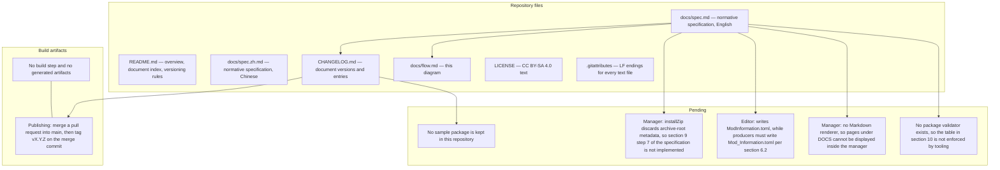

# Repository structure, publishing and pending work

## Files

## Build artifacts

No build step exists. Every file is written and committed as is; nothing is generated, so nothing
has to be kept out of version control beyond editor backups.

Publishing a document version: merge a pull request into `main`, then create a tag `vX.Y.Z` on the
merge commit with the matching `CHANGELOG.md` entry.

## Pending work

| Item | Scope | Reference |
| --- | --- | --- |
| Retain archive-root metadata on import | Mod manager | `docs/spec.md` section 9, step 7 |
| Write `Mod_Information.toml` with the underscored name | Mod editor | `docs/spec.md` section 6.2 |
| Render pages under `DOCS` | Mod manager | `docs/spec.md` section 7 |
| Validate packages against the table | Tooling | `docs/spec.md` section 10 |
| Ship a sample package | Both consumers | `docs/spec.md` section 4.4 |
